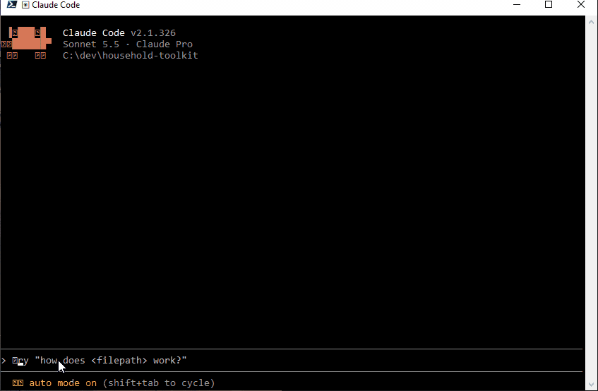

# household-toolkit

Claude skills and agents for running a busy household.

## What's inside

| Name | Type | What it does |
|------|------|--------------|
| `meal-planner` | Skill | Your weekday themes, food exclusions and recipes → a dated dinner plan for the rest of the month. |

## Quick start

macOS / Linux:

```bash
git clone https://github.com/prestonberrett/household-toolkit.git
cp -r skills/meal-planner ~/.claude/skills/
```

Windows (PowerShell):

```powershell
git clone https://github.com/prestonberrett/household-toolkit.git
Copy-Item -Recurse skills\meal-planner "$HOME\.claude\skills\meal-planner"
```

Then ask Claude: `"Plan my dinners for the rest of the month."`

Run it from any folder except this repo. On the first run the skill asks where to save your plans and recipes, and writes your settings next to the installed `SKILL.md`.

## Meal planner

**Problem:** Deciding what's for dinner every night was a daily chore. Fixed weekday themes remove most of the decision, but rotating the actual recipes and avoiding repeats still took effort every month.

**How it works:** Reads preferences.md (themes per weekday, exclusions, recipe sources, repeat window), pulls dishes from your recipe files, and builds a dated Date | Recipe table with a short notes section. The first run asks a few setup questions and writes preferences.md. After that it only asks when a theme runs out of dishes.



**Example:**

- **Prompt:** Plan my dinners for the rest of the month.
- **Result:** [examples/meal-planner.md](examples/meal-planner.md)

**Design notes:** Themes are fixed and recipes rotate, so the weekly structure never changes and variety comes from the rotation. Personal choices live in preferences.md, not SKILL.md, so the skill stays generic and sharing it doesn't expose anyone's setup. Longer version in [docs/meal-planner.md](docs/meal-planner.md).

## Repo layout

```
skills/   one folder per skill, each with SKILL.md
agents/   subagent definitions (coming soon)
examples/ sample transcripts
docs/     design notes
```

## Conventions

- Skill folders are kebab-case; the folder name matches the name: in SKILL.md.
- Every skill has a SKILL.md with a trigger-focused description, an output format, and a stated fallback for missing inputs. Personal settings go in a separate preferences file.

## Roadmap

- [ ] agents/recipe-finder

## License

MIT